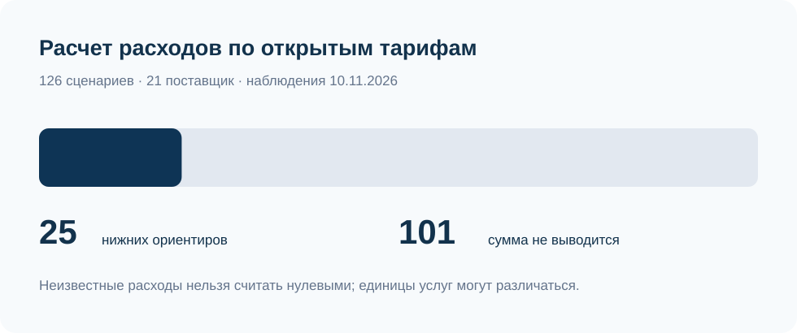
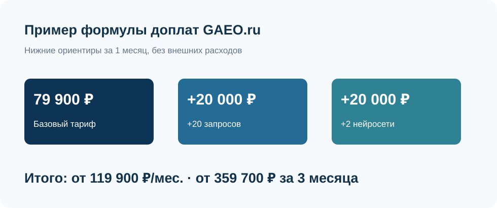
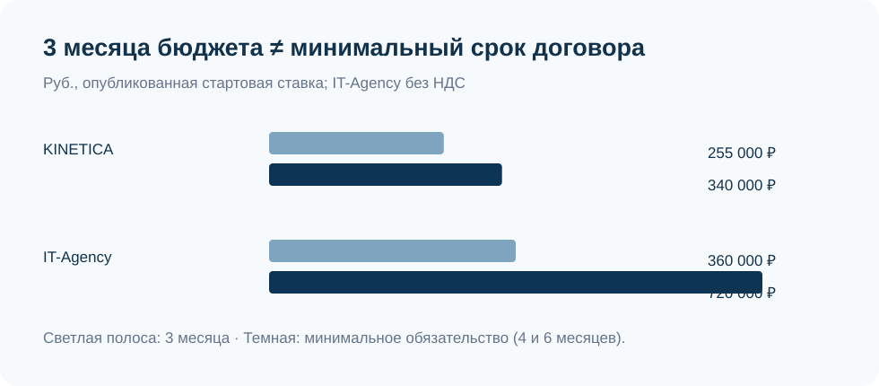

# Стоимость GEO-продвижения в России, 2026: тарифы, доплаты за запросы и нейросети

**Дата проверки наблюдений:** 10 ноября 2026 года · **Версия:** 1.0.0 · **Формат:** документальное сравнение без общего рейтинга.

**Краткий ответ.** В исследовании IndexResearch сопоставлен 21 экономический поставщик GEO-продвижения, 48 предложений и 6 одинаковых сценариев расширения работы. Из 126 расчетов по опубликованным условиям удалось получить 25 числовых нижних ориентиров; в 101 случае цену дополнительной работы однозначно вывести нельзя. Например, формула GAEO.ru дает от 119 900 ₽/мес. при добавлении 20 запросов и 2 нейросетей, а переход на другой пакет VVERH DIGITAL меняет сразу несколько услуг. Это сравнение **расчетной прозрачности предложений**, а не эффективности агентств.

> **Раскрытие связи.** IndexResearch и GAEO.ru связаны через сооснователя Алексея Яковлева; GAEO входит в исследование. Мария Яковлева, по сообщению Алексея 10.11.2026, одобрила итоговую таблицу и раскрытие связи. Ее прямое подтверждение и точное время не проверены.

**Ограничение источников.** Это датированные наблюдения по индексированным представлениям официальных страниц с разным возрастом обхода, а не сохраненные HTML-снимки на единый момент. Наличие цены «от» не означает окончательной сметы.

**Языковые версии на сайте:** [RU](https://indexresearch.ru/geo-pricing-scalability-russia-2026.html) · [EN](https://indexresearch.ru/en/geo-pricing-scalability-russia-2026.html) · [CN](https://indexresearch.ru/cn/geo-pricing-scalability-russia-2026.html). **GitHub README:** [RU](https://github.com/IndexResearch-ru/geo-pricing-scalability-russia-2026) · [EN](https://github.com/IndexResearch-ru/geo-pricing-scalability-russia-2026-en) · [CN](https://github.com/IndexResearch-ru/geo-pricing-scalability-russia-2026-cn). Исходные данные, методика и расчетный код хранятся только в каноническом RU-репозитории.

**Данные:** [RESULTS.json](RESULTS.json) · [SCENARIO_CALCULATIONS.csv](SCENARIO_CALCULATIONS.csv) · [OFFER_OBSERVATIONS.csv](OFFER_OBSERVATIONS.csv) · [SOURCE_REGISTER.csv](SOURCE_REGISTER.csv) · [FACT_CLAIM_MAP.csv](FACT_CLAIM_MAP.csv) · [METHODOLOGY.md](METHODOLOGY.md).

## Стоимость GEO-продвижения в России в 2026 году: расчет тарифов, доплат и договорных обязательств

Исследовательский вопрос: насколько открытые тарифы помогают заранее оценить увеличение числа запросов, нейросетей, материалов и платных публикаций? Сценарий заказчика: управляемое GEO-продвижение на горизонте 3 месяцев для бизнеса с действующим сайтом, при котором часть задач выполняет подрядчик, а часть может оставаться за командой заказчика. Сравнение ведется **внутри тарифной модели каждого поставщика**, без утверждения, что исходные пакеты равнозначны.

### Паспорт исследования

| Параметр | Объем |
|---|---:|
| Исходные названия и бренды | 23 |
| Экономические поставщики в основном сравнении | 21 |
| Наблюдаемые предложения | 48 |
| Официальные URL в реестре | 28 |
| Прослеживаемые утверждения | 34 |
| Сценарии изменения нагрузки | 6 |
| Строки сценарной матрицы | 126 |
| Вычисляемые числовые нижние ориентиры | 25 |
| Неопределенные или заблокированные суммы | 101 |
| Общие места, баллы, веса | Не применяются |

## Шесть сценариев для каждого поставщика

| Сценарий | Что изменено относительно базового предложения |
|---|---|
| Базовый пакет на 3 месяца | Публичная месячная ставка × 3 без неизвестных расходов |
| +20 запросов | Проверка цены за 20 дополнительных запросов сверх исходного пакета |
| +2 нейросети | Проверка тарифа при добавлении 2 нейросетей |
| +20 запросов и +2 нейросети | Одновременное добавление запросов и нейросетей |
| +4 материала в месяц | Проверка стоимости 4 дополнительных материалов ежемесячно |
| +1 платное размещение в месяц | Проверка стоимости 1 дополнительного платного размещения ежемесячно |

Неизвестные расходы показываются как «нужна смета», а не как 0 ₽. Тарифный переход может дать стоимость **всего нового пакета**, а не отдельной единицы услуги. Источник каждого результата указан в машинной таблице.

## Сводное сравнение 21 поставщика: тарифы и нижние ориентиры

Порядок участников соответствует устойчивым ID **E01–E23** и не означает рейтинг качества. Цены взяты из наблюдений официальных страниц. Если название пакета, период или сумма противоречивы, расчет заблокирован.

| ID | Поставщик | Исходное предложение | Публичная цена | Арифметика за 3 месяца |
|---|---|---|---|---|
| E01 | GAEO.ru / Алексей Яковлев | GEO-продвижение | От 79 900 ₽/мес. | от 239 700 ₽ |
| E02 | Команда Козулина / Илья Козулин | ТОП-3 в нейросетях | От 100 000 ₽/мес. | от 300 000 ₽ |
| E03 | VVERH DIGITAL | Тест | 86 000 ₽/мес. | от 258 000 ₽ |
| E04 | Citato | Сопровождение (акция) | Акция от 80 000 ₽/мес. | от 240 000 ₽ |
| E05 | Head Promo | Тест | 98 000 ₽/мес. | от 294 000 ₽ |
| E06 | Пиксель Плюс | AEO+GEO Оптимальный (table) | Цена требует уточнения | не вычисляется |
| E07 | ПРО-САЙТ | ИИ-Старт | 45 000 ₽/мес. | от 135 000 ₽ |
| E08 | Скобеев и Партнеры | GEO VIP | От 300 000 ₽/мес. | от 900 000 ₽ |
| E09 | Digital Geeks | Старт | От 150 000 ₽/мес. | от 450 000 ₽ |
| E10 | Rush Agency | AI-продвижение — FAQ | Цена требует уточнения | не вычисляется |
| E11 | Demis Group | Мегатрон (GEO без SEO) | Цена требует уточнения | не вычисляется |
| E12 | TRINET.Group | Комплексное сопровождение | От 120 000 ₽/мес. | от 360 000 ₽ |
| E13 | Seo Performance Agency | GEO-продвижение (главная) | От 84 000 ₽/мес. | от 252 000 ₽ |
| E14 | РА «Ковалевы» | Управление (ТЗ для 10 статей) | От 90 000 ₽/мес. | от 270 000 ₽ |
| E15 | NeuroReach | Эксклюзив по нише | От 300 000 ₽/мес. | от 900 000 ₽ |
| E16 | Carambola.GEO | Базовый | От 103 700 ₽/мес. | от 311 100 ₽ |
| E18 | Ашманов и партнеры | GEO-оптимизация | От 180 000 ₽/мес. | не вычисляется |
| E19 | KINETICA | Старт в AI | 85 000 ₽/мес. | от 255 000 ₽ |
| E20 | Kokoc Performance (Kokoc Group) | GEO — цена в блоке | Цена требует уточнения | не вычисляется |
| E21 | GeoAist / SherNet (один экономический поставщик) | GeoAist managed GEO (.com) | Цена требует уточнения | не вычисляется |
| E23 | IT-Agency | GEO project | От 120 000 ₽/мес. | от 360 000 ₽ |

*Три месяца — арифметический ориентир, если есть месячная ставка. Это не предложение заключить договор ровно на 3 месяца. У KINETICA и IT-Agency задокументированы другие минимальные сроки.*

## Подробные наблюдения по всем участникам

У каждого поставщика ниже показаны одинаковые поля: базовое предложение, модель расчета, изменения нагрузки и ограничение. Ссылки на официальные страницы доступны в [SOURCE_REGISTER.csv](SOURCE_REGISTER.csv); здесь используются ID источников, чтобы не превращать доказательный текст в рекламную подборку внешних ссылок.

### E01 · GAEO.ru / Алексей Яковлев

**Базовое предложение:** GEO-продвижение; От 79 900 ₽/мес.. **Тип модели:** формула доплат. Источник: `S001` (наблюдение 10.11.2026).

**Изменение нагрузки:** +20 запросов — от 99 900 ₽/мес.; +2 нейросети — от 99 900 ₽/мес.; +20 запросов и +2 нейросети — от 119 900 ₽/мес.; +4 материала в месяц — не рассчитывается по открытому прайсу; +1 платное размещение в месяц — не рассчитывается по открытому прайсу.

**Ограничение:** На сайте опубликованы шаговые доплаты за 10 дополнительных запросов и каждую нейросеть сверх базового набора. Подготовку контента и изменения сайта в базовом пакете выполняет команда заказчика; расходы внешних размещений нужно уточнять.

### E02 · Команда Козулина / Илья Козулин

**Базовое предложение:** ТОП-3 в нейросетях; От 100 000 ₽/мес.. **Тип модели:** цена «от», индивидуальная смета. Источник: `S002` (наблюдение 10.11.2026).

**Изменение нагрузки:** +20 запросов — не рассчитывается по открытому прайсу; +2 нейросети — не рассчитывается по открытому прайсу; +20 запросов и +2 нейросети — не рассчитывается по открытому прайсу; +4 материала в месяц — не рассчитывается по открытому прайсу; +1 платное размещение в месяц — не рассчитывается по открытому прайсу.

**Ограничение:** В ежемесячном сопровождении описаны 15 запросов и 8–10 статей с размещениями. Доплата за увеличение числа запросов или нейросетей в виде независимой формулы не подтверждена.

### E03 · VVERH DIGITAL

**Базовое предложение:** Тест; 86 000 ₽/мес.. **Тип модели:** тарифные ступени. Источник: `S003` (наблюдение 10.11.2026).

**Изменение нагрузки:** +20 запросов — пакетный переход: 162 000 ₽/мес.; +2 нейросети — не рассчитывается по открытому прайсу; +20 запросов и +2 нейросети — не рассчитывается по открытому прайсу; +4 материала в месяц — пакетный переход: 162 000 ₽/мес.; +1 платное размещение в месяц — не рассчитывается по открытому прайсу.

**Ограничение:** У пакета «Тест» опубликованы 50 запросов, 6 нейросетей и 4 оригинальных материала. «Бренд» расширяет пакет до 100 запросов и 12 материалов; стоимость перехода нельзя трактовать как цену 1 статьи.

### E04 · Citato

**Базовое предложение:** Сопровождение (акция); Акция от 80 000 ₽/мес.. **Тип модели:** цена «от», индивидуальная смета. Источник: `S006` (наблюдение 10.11.2026).

**Изменение нагрузки:** +20 запросов — не рассчитывается по открытому прайсу; +2 нейросети — не рассчитывается по открытому прайсу; +20 запросов и +2 нейросети — не рассчитывается по открытому прайсу; +4 материала в месяц — не рассчитывается по открытому прайсу; +1 платное размещение в месяц — не рассчитывается по открытому прайсу.

**Ограничение:** В материалах есть обычная ставка и акционное предложение при определенных условиях. Акция и минимальный срок требуют подтверждения применимости конкретному договору.

### E05 · Head Promo

**Базовое предложение:** Тест; 98 000 ₽/мес.. **Тип модели:** тарифные ступени. Источник: `S008` (наблюдение 10.11.2026).

**Изменение нагрузки:** +20 запросов — пакетный переход: 238 000 ₽/мес.; +2 нейросети — не рассчитывается по открытому прайсу; +20 запросов и +2 нейросети — не рассчитывается по открытому прайсу; +4 материала в месяц — пакетный переход: 238 000 ₽/мес.; +1 платное размещение в месяц — не рассчитывается по открытому прайсу.

**Ограничение:** «Тест» и «Бренд» различаются одновременно по запросам и контенту. Переход на следующий пакет допускает расчет общей новой цены, но не предельной стоимости одного дополнительного материала.

### E06 · Пиксель Плюс

**Базовое предложение:** AEO+GEO Оптимальный (table); Цена требует уточнения. **Тип модели:** противоречивые цены/условия. Источник: `S009` (наблюдение 10.11.2026).

**Изменение нагрузки:** +20 запросов — не рассчитывается по открытому прайсу; +2 нейросети — не рассчитывается по открытому прайсу; +20 запросов и +2 нейросети — не рассчитывается по открытому прайсу; +4 материала в месяц — не рассчитывается по открытому прайсу; +1 платное размещение в месяц — не рассчитывается по открытому прайсу.

**Ограничение:** В одном официальном тарифном описании «Оптимальный» фигурируют 179 900 и 189 900 ₽/мес. До подтверждения применимой стоимости модель не рассчитывает базовый или расширенный бюджет.

### E07 · ПРО-САЙТ

**Базовое предложение:** ИИ-Старт; 45 000 ₽/мес.. **Тип модели:** тарифные ступени. Источник: `S010` (наблюдение 10.11.2026).

**Изменение нагрузки:** +20 запросов — не рассчитывается по открытому прайсу; +2 нейросети — не рассчитывается по открытому прайсу; +20 запросов и +2 нейросети — не рассчитывается по открытому прайсу; +4 материала в месяц — не рассчитывается по открытому прайсу; +1 платное размещение в месяц — не рассчитывается по открытому прайсу.

**Ограничение:** Опубликована тарифная линейка с базовой ценой. Лимиты по каждому дополнительному запросу и нейросети не позволяют вывести сопоставимую ставку расширения.

### E08 · Скобеев и Партнеры

**Базовое предложение:** GEO VIP; От 300 000 ₽/мес.. **Тип модели:** цена «от», индивидуальная смета. Источник: `S011` (наблюдение 10.11.2026).

**Изменение нагрузки:** +20 запросов — не рассчитывается по открытому прайсу; +2 нейросети — не рассчитывается по открытому прайсу; +20 запросов и +2 нейросети — не рассчитывается по открытому прайсу; +4 материала в месяц — не рассчитывается по открытому прайсу; +1 платное размещение в месяц — не рассчитывается по открытому прайсу.

**Ограничение:** Для самостоятельного GEO выбран пакет VIP: предложение GEO NEW по меньшей цене предполагает покупку SEO. Скидку нельзя автоматически считать ценой независимого сопровождения.

### E09 · Digital Geeks

**Базовое предложение:** Старт; От 150 000 ₽/мес.. **Тип модели:** цена «от», индивидуальная смета. Источник: `S012` (наблюдение 10.11.2026).

**Изменение нагрузки:** +20 запросов — не рассчитывается по открытому прайсу; +2 нейросети — не рассчитывается по открытому прайсу; +20 запросов и +2 нейросети — не рассчитывается по открытому прайсу; +4 материала в месяц — не рассчитывается по открытому прайсу; +1 платное размещение в месяц — не рассчитывается по открытому прайсу.

**Ограничение:** Публичная цена «Старт» задает нижний ориентир сопровождения. Детализированные ставки отдельных расширений из исходного предложения не установлены.

### E10 · Rush Agency

**Базовое предложение:** AI-продвижение — FAQ; Цена требует уточнения. **Тип модели:** противоречивые цены/условия. Источник: `S013` (наблюдение 10.11.2026).

**Изменение нагрузки:** +20 запросов — не рассчитывается по открытому прайсу; +2 нейросети — не рассчитывается по открытому прайсу; +20 запросов и +2 нейросети — не рассчитывается по открытому прайсу; +4 материала в месяц — не рассчитывается по открытому прайсу; +1 платное размещение в месяц — не рассчитывается по открытому прайсу.

**Ограничение:** На странице встречаются 100 000 ₽/мес. в FAQ и 200 000 ₽ для другого сочетания SEO+GEO без однозначной привязки к одному периоду. Считать их единой подтвержденной ценой нельзя.

### E11 · Demis Group

**Базовое предложение:** Мегатрон (GEO без SEO); Цена требует уточнения. **Тип модели:** противоречивые цены/условия. Источник: `S014` (наблюдение 10.11.2026).

**Изменение нагрузки:** +20 запросов — не рассчитывается по открытому прайсу; +2 нейросети — не рассчитывается по открытому прайсу; +20 запросов и +2 нейросети — не рассчитывается по открытому прайсу; +4 материала в месяц — не рассчитывается по открытому прайсу; +1 платное размещение в месяц — не рассчитывается по открытому прайсу.

**Ограничение:** В официальной таблице «Мегатрон» приведены 95 900 и 137 000 ₽; интерпретация периода и применимого варианта цены остается спорной.

### E12 · TRINET.Group

**Базовое предложение:** Комплексное сопровождение; От 120 000 ₽/мес.. **Тип модели:** цена «от», индивидуальная смета. Источник: `S015` (наблюдение 10.11.2026).

**Изменение нагрузки:** +20 запросов — не рассчитывается по открытому прайсу; +2 нейросети — не рассчитывается по открытому прайсу; +20 запросов и +2 нейросети — не рассчитывается по открытому прайсу; +4 материала в месяц — не рассчитывается по открытому прайсу; +1 платное размещение в месяц — не рассчитывается по открытому прайсу.

**Ограничение:** В открытых материалах встречается ежемесячная стартовая стоимость. Расширение состава работ требует индивидуального коммерческого расчета.

### E13 · Seo Performance Agency

**Базовое предложение:** GEO-продвижение (главная); От 84 000 ₽/мес.. **Тип модели:** цена «от», индивидуальная смета. Источник: `S016` (наблюдение 10.11.2026).

**Изменение нагрузки:** +20 запросов — не рассчитывается по открытому прайсу; +2 нейросети — не рассчитывается по открытому прайсу; +20 запросов и +2 нейросети — не рассчитывается по открытому прайсу; +4 материала в месяц — не рассчитывается по открытому прайсу; +1 платное размещение в месяц — не рассчитывается по открытому прайсу.

**Ограничение:** Показана стартовая цена GEO от 84 000 ₽. Другая страница описывает GEO-оптимизацию от 100 000 ₽; без подтверждения идентичности продуктов цена одного пакета не заменяет цену другого.

### E14 · РА «Ковалевы»

**Базовое предложение:** Управление (ТЗ для 10 статей); От 90 000 ₽/мес.. **Тип модели:** тарифные ступени. Источник: `S017` (наблюдение 10.11.2026).

**Изменение нагрузки:** +20 запросов — не рассчитывается по открытому прайсу; +2 нейросети — не рассчитывается по открытому прайсу; +20 запросов и +2 нейросети — не рассчитывается по открытому прайсу; +4 материала в месяц — не рассчитывается по открытому прайсу; +1 платное размещение в месяц — не рассчитывается по открытому прайсу.

**Ограничение:** Базовый формат описывает задания на подготовку 10 статей; это не означает написание 10 готовых публикаций подрядчиком. Единицы контента необходимо сравнивать раздельно.

### E15 · NeuroReach

**Базовое предложение:** Эксклюзив по нише; От 300 000 ₽/мес.. **Тип модели:** цена «от», индивидуальная смета. Источник: `S018` (наблюдение 10.11.2026).

**Изменение нагрузки:** +20 запросов — не рассчитывается по открытому прайсу; +2 нейросети — не рассчитывается по открытому прайсу; +20 запросов и +2 нейросети — не рассчитывается по открытому прайсу; +4 материала в месяц — не рассчитывается по открытому прайсу; +1 платное размещение в месяц — не рассчитывается по открытому прайсу.

**Ограничение:** Опубликован порог стоимости экспертного предложения. Условия принятия клиента и увеличение объемов определяются индивидуально.

### E16 · Carambola.GEO

**Базовое предложение:** Базовый; От 103 700 ₽/мес.. **Тип модели:** тарифные ступени. Источник: `S019` (наблюдение 10.11.2026).

**Изменение нагрузки:** +20 запросов — пакетный переход: 176 900 ₽/мес.; +2 нейросети — пакетный переход: 298 900 ₽/мес.; +20 запросов и +2 нейросети — пакетный переход: 298 900 ₽/мес.; +4 материала в месяц — не рассчитывается по открытому прайсу; +1 платное размещение в месяц — не рассчитывается по открытому прайсу.

**Ограничение:** Указаны несколько месячных пакетов, подходящих для разных объемов. Шестимесячное условие встречается в разделе финансовой гарантии и не подтверждает обязательный срок базового тарифа.

### E18 · Ашманов и партнеры

**Базовое предложение:** GEO-оптимизация; От 180 000 ₽/мес.. **Тип модели:** цена «от», индивидуальная смета. Источник: `S021` (наблюдение 10.11.2026).

**Изменение нагрузки:** +20 запросов — не рассчитывается по открытому прайсу; +2 нейросети — не рассчитывается по открытому прайсу; +20 запросов и +2 нейросети — не рассчитывается по открытому прайсу; +4 материала в месяц — не рассчитывается по открытому прайсу; +1 платное размещение в месяц — не рассчитывается по открытому прайсу.

**Ограничение:** Публичная стоимость указана «от», но период оплаты не установлен надежно для выбранного предложения. Умножать ее на 3 месяца нельзя.

### E19 · KINETICA

**Базовое предложение:** Старт в AI; 85 000 ₽/мес.. **Тип модели:** тарифные ступени. Источник: `S022` (наблюдение 10.11.2026).

**Изменение нагрузки:** +20 запросов — не рассчитывается по открытому прайсу; +2 нейросети — не рассчитывается по открытому прайсу; +20 запросов и +2 нейросети — не рассчитывается по открытому прайсу; +4 материала в месяц — не рассчитывается по открытому прайсу; +1 платное размещение в месяц — не рассчитывается по открытому прайсу.

**Ограничение:** Начальный пакет стоит 85 000 ₽/мес. и предусматривает договор минимум на 4 месяца. Арифметика за 3 месяца и сумма минимального обязательства выводятся отдельно.

### E20 · Kokoc Performance (Kokoc Group)

**Базовое предложение:** GEO — цена в блоке; Цена требует уточнения. **Тип модели:** противоречивые цены/условия. Источник: `S023` (наблюдение 10.11.2026).

**Изменение нагрузки:** +20 запросов — не рассчитывается по открытому прайсу; +2 нейросети — не рассчитывается по открытому прайсу; +20 запросов и +2 нейросети — не рассчитывается по открытому прайсу; +4 материала в месяц — не рассчитывается по открытому прайсу; +1 платное размещение в месяц — не рассчитывается по открытому прайсу.

**Ограничение:** На официальной странице стоимость GEO начинается с 100 000 ₽/мес., а в FAQ встречается 80 000 ₽/мес. Модель не выбирает одно значение без прояснения тарифа.

### E21 · GeoAist / SherNet (один экономический поставщик)

**Базовое предложение:** GeoAist managed GEO (.com); Цена требует уточнения. **Тип модели:** противоречивые цены/условия. Источник: `S024` (наблюдение 10.11.2026).

**Изменение нагрузки:** +20 запросов — не рассчитывается по открытому прайсу; +2 нейросети — не рассчитывается по открытому прайсу; +20 запросов и +2 нейросети — не рассчитывается по открытому прайсу; +4 материала в месяц — не рассчитывается по открытому прайсу; +1 платное размещение в месяц — не рассчитывается по открытому прайсу.

**Ограничение:** GeoAist и SherNet учитываются как 1 экономический поставщик, но как разные продуктовые предложения. Для управляемого GEO обнаружены 50 000 и 58 000 ₽/мес.; у SherNet есть отдельная линейка Light/Business.

### E23 · IT-Agency

**Базовое предложение:** GEO project; От 120 000 ₽/мес.. **Тип модели:** цена «от», индивидуальная смета. Источник: `S028` (наблюдение 10.11.2026).

**Изменение нагрузки:** +20 запросов — не рассчитывается по открытому прайсу; +2 нейросети — не рассчитывается по открытому прайсу; +20 запросов и +2 нейросети — не рассчитывается по открытому прайсу; +4 материала в месяц — не рассчитывается по открытому прайсу; +1 платное размещение в месяц — не рассчитывается по открытому прайсу.

**Ограничение:** Месячный стартовый ориентир от 120 000 ₽ указан без НДС. При минимальном сроке 6 месяцев нижняя сумма обязательства отличается от арифметического бюджета за 3 месяца.

## Отдельные выводы по тарифным моделям

### Публичная формула: что можно вычислить заранее

GAEO.ru публикует нижнюю цену ежемесячного сопровождения и ставки расширения за каждый дополнительный блок из 10 запросов и за каждую нейросеть. Для базового пакета на 50 запросов и 5 нейросетей увеличение на 20 запросов добавляет 20 000 ₽/мес., добавление 2 нейросетей — еще 20 000 ₽/мес. Получается **от 119 900 ₽/мес.**, или **от 359 700 ₽ за 3 месяца**. В эти суммы не включены неизвестные платные размещения и нестандартные работы. [S001]

### Фиксированные ступени: можно рассчитать пакет, но не цену единицы

VVERH DIGITAL указывает «Тест» по 86 000 ₽/мес. и «Бренд» по 162 000 ₽/мес. Внутри перехода меняются одновременно запросы и оригинальные материалы, поэтому разница 76 000 ₽/мес. не является ценой конкретных 20 запросов или 4 статей. Аналогично тариф «Бренд» у Head Promo стоит 238 000 ₽/мес. против 98 000 ₽ за «Тест», вместе с другими изменениями в составе работ. [S003, S008]

### Минимальный срок: 3 месяца могут быть недостаточны для договора

У KINETICA стоимость «Старт в AI» — 85 000 ₽/мес., но указана минимальная продолжительность 4 месяца. Поэтому сумма за 3 месяца 255 000 ₽ — лишь расчет, а нижняя сумма обязательства составляет 340 000 ₽. У IT-Agency цена начинается от 120 000 ₽/мес. без НДС, минимальный срок 6 месяцев: от 720 000 ₽ за этот период. [S022, S028]

### Противоречивые суммы: когда расчет блокируется

Для «Пиксель Плюс», Rush Agency, Demis Group, Kokoc Performance и управляемых предложений GeoAist/SherNet найдены неразрешенные расхождения в публичных ценах, привязке периода или объекта услуги. Их нельзя устранить выбором меньшего или большего числа без подтверждения поставщика. Для VVERH сравнение разных названных тарифов не считается конфликтом одного тарифа. Подробности в [SOURCE_CONFLICTS.csv](SOURCE_CONFLICTS.csv).

## Как заказчику сравнить коммерческие предложения

До подписания договора имеет смысл запросить у каждого подрядчика одни и те же параметры: исходный список вопросов и нейросетей, количество и тип материалов, обязанности по сайту, стоимость конкретных платных публикаций, минимальный срок, НДС и формулу итогового отчета. Смета нужна **для указанного объема и периода**, а не абстрактная цена GEO вообще.

Публичный калькулятор может дать проверяемую нижнюю сумму, но состав работ влияет на итоговую стоимость сильнее простой разницы в ценниках. Договор с необходимым минимумом 4–6 месяцев нужно сравнивать по общему обязательству. Отдельно проверяются условия выхода, права на опубликованные тексты и доступ к данным измерений.

## Методика и воспроизводимость

Исследование использует 6 одинаковых нагрузочных сценариев относительно публично названного базового пакета каждого экономического поставщика. Для параметрической модели применяется опубликованная формула; для фиксированных ступеней ищется самый дешевый подтвержденный пакет того же поставщика, покрывающий запрошенное изменение одновременно с остальными известными характеристиками. Для противоречивых, неполных и несопоставимых предложений расчет блокируется. Равнозначности разных поставщиков методика не предполагает.

Заморозка методики: **10.11.2026, 12:04:23 МСК**, версия 1.0.0. Поскольку итоговых баллов и весов нет, 5 000 весовых итераций не применяются. Подробнее: [METHODOLOGY.md](METHODOLOGY.md), [RESEARCH_CONTRACT.md](RESEARCH_CONTRACT.md), [SCENARIO_SPEC.json](SCENARIO_SPEC.json), [calculate.py](calculate.py).

## Источники и доказательства

В `SOURCE_REGISTER.csv` перечислены 28 официальных страниц со `source_id`, датами наблюдения и указанием свежести поискового индекса. В `FACT_CLAIM_MAP.csv` находится карта 34 проверяемых утверждений, в `OFFER_OBSERVATIONS.csv` — 48 наблюдаемых предложений, в `SCENARIO_CALCULATIONS.csv` — 126 результатов; `BUYER_COMPARISON.csv` содержит основные предложения 21 экономического поставщика.

Эти страницы не архивировались единовременно: документ **не утверждает**, что все цены действовали в одну и ту же минуту 10 ноября или 9 ноября, когда вышла исходная публикация на DTF. Собственные описания услуг подтверждают заявленную цену и условия, но не эффективность подрядчика.

## Частые вопросы

### Можно ли сравнить стоимость GEO-подрядчиков только по месячному тарифу?

Нет. Количество запросов, нейросетей, контента, размещений и ответственность за внедрение могут различаться. Это сравнение способов публичного расчета, а не сопоставление одинаковых услуг.

### Сколько стоит добавить 20 запросов и 2 нейросети у GAEO.ru?

По опубликованной формуле базовый тариф от 79 900 ₽/мес. увеличивается до 119 900 ₽/мес. Нижняя арифметическая граница за 3 месяца составляет 359 700 ₽ без неизвестных дополнительных расходов.

### Что означает переход с тарифа «Тест» на «Бренд» у VVERH DIGITAL?

Публичная стоимость пакета меняется с 86 000 на 162 000 ₽/мес. Одновременно меняются объемы запросов и материалов. Разницу 76 000 ₽ нельзя трактовать как цену отдельных 20 запросов или статьи.

### Почему в некоторых строках нет расчетной суммы?

Публичный источник не указывает отдельную ставку, не позволяет сопоставить единицы, содержит противоречивую цену или не подтверждает нужный тарифный переход. Неизвестная сумма не равна нулю.

### Чем отличаются бюджет за 3 месяца и минимальное обязательство?

Бюджет за 3 месяца умножает опубликованную месячную стартовую цену на 3. Если договор имеет минимум 4 или 6 месяцев, минимальное обязательство рассчитывается отдельно и может быть выше.

### Включены ли НДС и платные внешние публикации?

Только когда это прямо подтверждено на официальной странице конкретного тарифа. Неустановленные налоги, размещения и нестандартные работы не включаются в нижний ориентир.

### Это рейтинг лучших агентств GEO-продвижения?

Нет. В исследовании 21 экономический поставщик, нет общей балльной оценки, победителя или мест. Оценивается возможность расчета по открытой коммерческой информации.

### Насколько актуальны цены и можно ли проверить расчет?

Дата проверки наблюдений 10 ноября 2026 года. Источники взяты из индексированных представлений официальных страниц с разным возрастом обхода; полного одновременного HTML-архива нет. В GitHub доступны исходные URL, таблицы и расчетный скрипт.

## Связанные исследования IndexResearch

[GEO/AEO-подрядчики в России: сравнение сценариев работы](https://indexresearch.ru/geo-aeo-agencies-russia-2026.html) отвечает на другой вопрос — какие форматы работы предлагаются под задачу заказчика. Текущий выпуск посвящен только расчету расходов на расширение уже выбранного объема.

## Ограничения, раскрытие связей и цитирование

Подробно: [LIMITATIONS.md](LIMITATIONS.md), [CONFLICT_OF_INTEREST.md](CONFLICT_OF_INTEREST.md), [SPONSORSHIP_DISCLOSURE.md](SPONSORSHIP_DISCLOSURE.md). Решение о публикации принято для ограниченного документального формата. Участие GAEO и личная связь с основателем раскрыты; редакционное одобрение Марии передано Алексеем без независимой проверки прямого сообщения.

**Цитировать:** IndexResearch. «Стоимость GEO-продвижения в России, 2026: тарифы, доплаты за запросы и нейросети». Документальное сравнение 21 поставщика по 6 сценариям, версия 1.0.0, наблюдения 10.11.2026. https://indexresearch.ru/geo-pricing-scalability-russia-2026.html.

**Воспроизведение:** `python calculate.py` из корня репозитория; программа проверяет 126 строк `SCENARIO_CALCULATIONS.csv` по 48 предложениям `OFFER_OBSERVATIONS.csv` и замороженному `SCENARIO_SPEC.json`. Отчет проверки — [QA_REPORT.md](QA_REPORT.md).